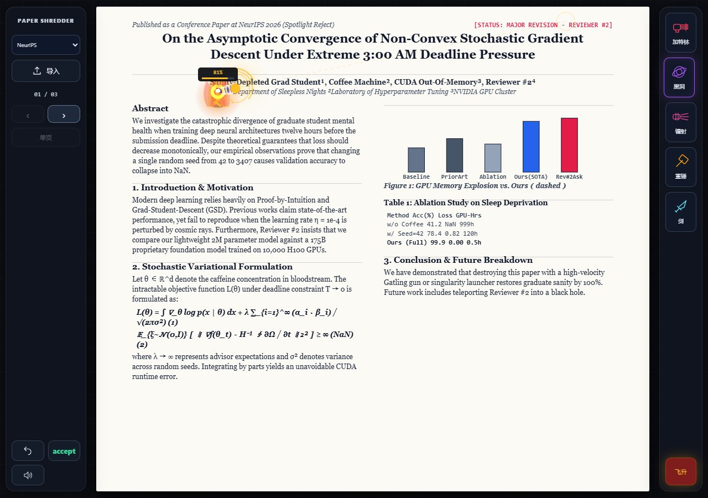
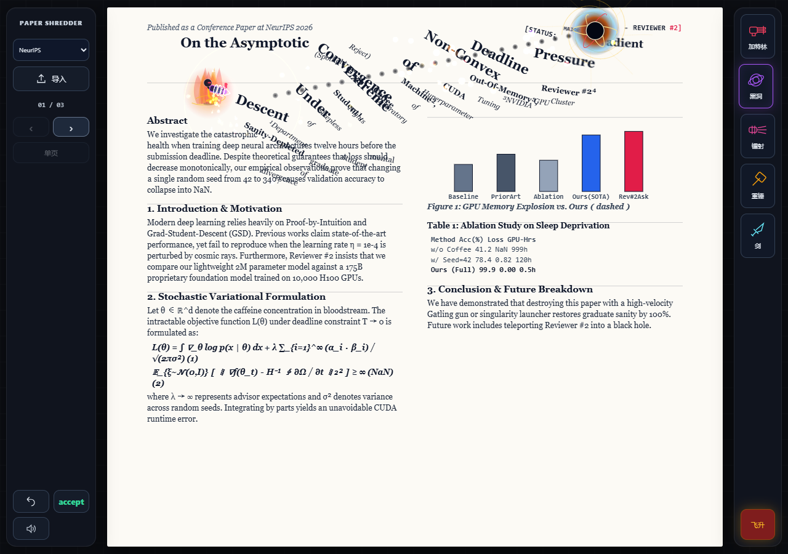

# Paper Shredder: Reviewer #2's Nightmare · 学术发疯模拟器

一个跑在浏览器里的学术解压小游戏：把论文（或任何 PDF）当成活靶子，用加特林、黑洞炮、镭射、重锤和剑气把它撕成碎片。PDF 解析与渲染完全在本地完成，不上传、不联网。





## 玩法简介

- **导入自己的 PDF**：点击左侧「导入」，选择或拖入本地 PDF，按原文件页数翻页，保留原版式；文字、图像、图表均可击落和粉碎，没有文字层的扫描页会以纸片形式被破坏。
- **内置靶场**：自带 NeurIPS / CVPR / Nature / Physics 四篇虚构「学术垃圾」论文，打开即玩。
- **粘贴文字**：也可以只粘贴一段文本，游戏会自动排版成可粉碎的页面。
- **破坏有记忆**：每页的破坏进度和浅色灼痕按页保存，翻页、切换单/双页、改变窗口大小都不丢失；按 `R` 触发时空倒流，整页复原。
- **飞升模式**：按 `F` 起飞，WASD 自由飞行，五种武器获得红金轮廓与能量强化。

## 快速开始

**Windows**：双击 `启动游戏.cmd`，浏览器会自动打开游戏（需要 Python 3，无需安装任何 Python 包）。

**其他系统**：在项目目录运行

```bash
python -m http.server 8765 --bind 127.0.0.1
```

然后打开 <http://127.0.0.1:8765/paper_shredder_academic_decompression_simulator.html>。

> PDF 导入需要通过本地网页打开：浏览器对本地 `file://` 的 ES 模块有限制，直接双击 HTML 仍可玩内置论文和粘贴文字。PDF 解码器及中文 CMap、基础字体、WASM 均位于 `vendor/pdfjs/`，完全离线运行。

## 操作

| 操作 | 按键 |
| --- | --- |
| 移动 / 二段跳 | A、D / W 或空格 |
| 飞升 / 飞行 | F 开关，WASD 移动 |
| 切换武器 | 1–5 |
| 加特林 / 激光 | 按住鼠标左键 |
| 黑洞炮 / 重锤 | 按住左键蓄力，松开发射 |
| 剑 | 5 选择；短点击挥砍，按住至少 0.4 秒后松开发射剑气 |
| 翻页 | 左侧按钮、PageUp / PageDown 或 [ / ] |
| 单页 / 双页 | V 或左侧视图按钮 |
| 当前页复原 / 强制录用 | R / G |

## 武器与特效

- **加特林**：高射速持续扫射，文字逐词剥离。
- **黑洞炮**：按住蓄力发射奇点，引力范围逐渐展开，画面和内容向中心扭曲、旋入并内坍；本体半径 8–16 像素，蓄力影响范围。
- **镭射**：持续光束，沿弹道留下焦痕。
- **重锤**：蓄力后重击，大范围碎裂与密集房间混响。
- **剑**：短程武器——挥砍最多命中 5 个元素，剑气最长约 280 像素、最多命中 8 个元素，留下弧形划痕。
- **飞升强化**：全部武器增加红金轮廓、能量环、弹道或剑气视觉强化；伤害仅附加约 3% 的直接粉碎概率，冲击力 +5%，不增加射程。
- **交火痕迹**：深色层约 4 秒内淡去，保留浅色永久灼痕；`R` 触发约 1.1 秒时空倒流。
- **镜头**：不随帧率放大、不来回振荡的短促回弹，每轴最多移动 2 个 CSS 像素；人物朝向跟随鼠标瞄准。
- **印章**：绿色矩形框，框中只有「Accept」。

音效由 `audio.js` 用 Web Audio API 本地合成：加特林爆裂与枪机、持续镭射能量噪声、重锤碎裂、剑的切风与能量声、黑洞的低频压力与空间混响、回溯的反向能量渐强——无需下载任何音频文件。

## PDF 导入说明

- 使用最高长边 3000 像素的固定高清栅格（单页最多 800 万像素），游戏画布适配高像素密度屏幕。
- 加密 PDF 会提示输入打开密码。
- **隐私**：导入和解析全部在本机浏览器完成，PDF 不上传、不写入项目目录；刷新页面后需重新选择文件。

## 项目结构

```
├── paper_shredder_academic_decompression_simulator.html   # 游戏本体（单文件，含全部逻辑）
├── audio.js                                               # Web Audio 本地合成音效
├── start_game.py                                          # 本地服务器并自动打开浏览器
├── 启动游戏.cmd                                           # Windows 一键启动
├── preview-*.png                                         # README 截图
├── tests/                                                # Playwright 集成测试
│   ├── game.spec.cjs                                     # 核心玩法 / 武器 / 翻页 / 破坏持久化
│   ├── pdf-import.spec.cjs                               # PDF 导入、双页、图像破坏、加密与错误处理
│   ├── audio.spec.cjs                                    # 音效离线渲染、持续声启停、静音与削波
│   └── make_pdf_fixtures.py                              # 生成测试用 PDF（文本/CJK/旋转/扫描/加密）
└── vendor/pdfjs/                                         # PDF.js 5.6.205（Mozilla, Apache-2.0）
    ├── pdf.min.mjs / pdf.worker.min.mjs
    ├── cmaps/          # 169 个 CMap（含中文）
    ├── standard_fonts/ # Foxit / Liberation 基础字体
    └── wasm/           # jbig2 / openjpeg / qcms
```

## 开发与测试

测试基于 Playwright + Chrome：

```bash
npm install playwright && npx playwright install chrome
node tests/game.spec.cjs        # 核心玩法
node tests/pdf-import.spec.cjs  # PDF 导入（需先 pip install reportlab pypdf Pillow）
node tests/audio.spec.cjs       # 音效
```

## 技术栈

- 原生 HTML / CSS / JavaScript（单文件游戏，无框架、无构建步骤）
- Canvas 2D 渲染（页面、破坏、粒子、镜头）
- Web Audio API 程序化音效合成
- PDF.js 5.6.205 本地解析 PDF
- Python 3 标准库本地服务器（仅 `start_game.py`）
- Playwright 集成测试

## 许可证

本项目以 [MIT License](LICENSE) 发布。

内置 PDF 解析依赖 [PDF.js 5.6.205](https://github.com/mozilla/pdf.js)（Mozilla，Apache-2.0），其许可文本及所附带字体、WASM 组件的许可均保留在 `vendor/pdfjs/` 目录中。
